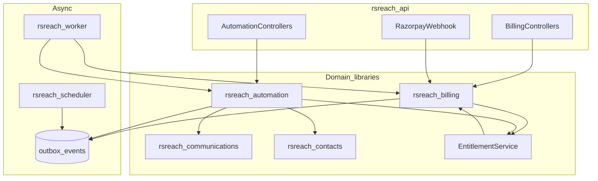
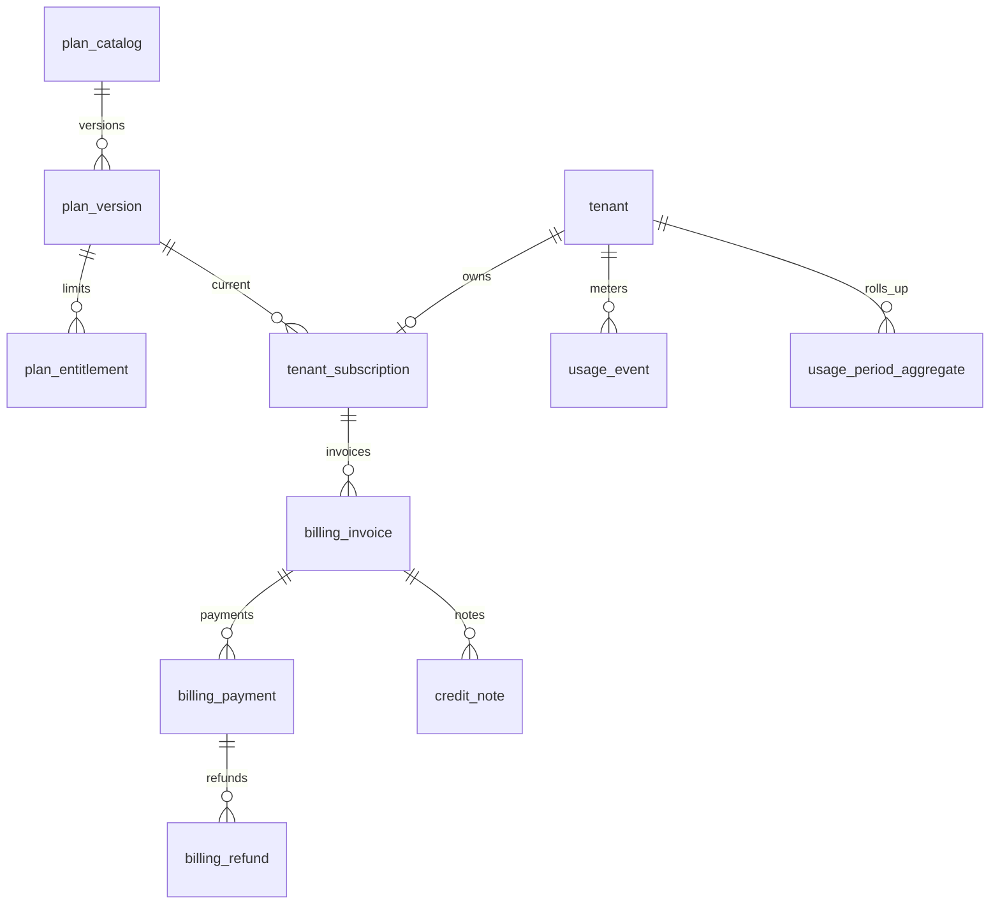
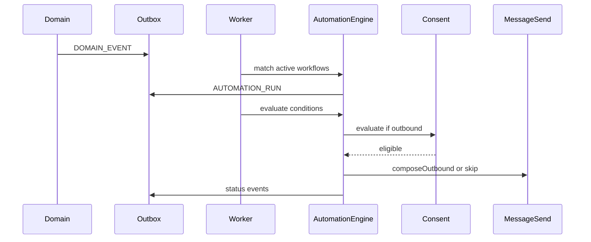

# Phase 4 — Billing, Subscriptions & Automation

**Status:** Implementation in progress (M0–M7)  
**ADRs:** 0010 (billing module), 0011 (automation module)  
**Flyway:** V24+ only (V1–V23 immutable)  
**Defaults applied for implementation:** D3 grace = 7 days; D4/D5 constrained linear automation authorized; D2 commercial prices not seeded as approved — Free plan provisional quotas for CI only; paid plan `price_paise` nullable until operator configures.

Source plan: Phase 4 Billing Automation Plan (Cursor). Question 7 remains unanswered and non-blocking.

---
## 1. What already exists (repo facts)

| Area | State |
|---|---|
| Processes | API / worker / scheduler + PostgreSQL; outbox claim/dispatch ([`OutboxEventDispatcher`](backend/rsreach-worker/src/main/java/com/rsreach/worker/runtime/OutboxEventDispatcher.java)) |
| Tenancy / auth | Dual-realm JWT; tenant + workspace isolation |
| Contacts / consent | `ConsentEvaluationService` fail-closed; campaigns re-check at enqueue |
| Communications | Conversations, WA/email mocks + live flags (Phase 3 / 3.5); campaigns V23 |
| Webhooks / secrets | `provider_webhook_events`, `integration_secrets`, AES-GCM |
| RBAC seed | SQL has `tenant.billing.read` + `FINANCE_ADMIN` role ([`V3__rbac_permissions_roles.sql`](backend/rsreach-persistence/src/main/resources/db/migration/V3__rbac_permissions_roles.sql)); **[`Permissions.java`](backend/rsreach-common/src/main/java/com/rsreach/common/Permissions.java) has no billing constants yet** |
| Billing Java / tables / UI | **None** — no `rsreach-billing` module |
| Automation / workflows | **None** — SOURCES lists advanced visual builders as future scope |
| Flyway | Latest **V23**; next is **V24+** only |
| Phase 3.5 | Verify green; residual ops risks remain (Compose `.env`, MinIO SigV4, Embedded Signup, Q7) |

**Authoritative billing rules:** [`rsreach-billing/SKILL.md`](.cursor/skills/rsreach-billing/SKILL.md) — Razorpay, INR paise `BIGINT`, plan **versions**, webhook-or-manual truth, GST-ready fields without inventing rates.

---

## 2. Unresolved decisions (need your approval)

| ID | Topic | Blocks? | Notes |
|---|---|---|---|
| **D1** | Discovery **Question 7** (shared vs per-channel communication groups) | **Does not block Phase 4** | Continue using Phase 2 contact groups for campaign/automation audiences; document stop-line |
| **D2** | Plan **prices**, quotas, trial length, GST rates | **Blocks seeding commercial numbers** | Schema + UI can ship with empty/config-admin rates; no transcript sample prices as “approved” |
| **D3** | `PAST_DUE` grace days before `SUSPENDED` | Soft-block M1 | Default proposal: **7 days** (confirm) |
| **D4** | Automation in Phase 4 vs defer | Soft-block M4+ | This plan **authorizes a constrained automation MVP** because you asked for it; confirm it overrides SOURCES “visual builders = future” for Phase 4 only |
| **D5** | Visual builder depth | Soft-block M6 | Propose **linear** trigger → conditions → actions (no freeform DAG / loops / parallel branches in MVP) |
| **D6** | Per-workspace Razorpay customers | No | MVP: **one subscription per tenant**; usage rollup by workspace |

**Phase 3.5 risks before production (not Phase 4 code):** Compose secrets/smoke; MinIO SigV4 harden; live Meta Embedded Signup; Q7 still open for product messaging groups.

---

## 3. Target architecture

### 3.1 Modules (ADRs before code)

| Module | Responsibility |
|---|---|
| **`rsreach-billing`** (new, ADR **0010**) | Plans/versions, subscriptions, payments, invoices, refunds/credit notes, entitlements API, usage events/aggregates, Razorpay adapter behind `PaymentGateway` |
| **`rsreach-automation`** (new, ADR **0011**) | Workflow definitions, versions, triggers, condition eval, action dispatch, execution runs, loop guards |
| Controllers | Thin in `rsreach-api` (`/api/v1/app/billing/*`, `/api/v1/app/automations/*`, `/api/v1/platform/billing/*`, `/api/v1/webhooks/razorpay`) |
| Worker | `BILLING_WEBHOOK_APPLY`, `USAGE_AGGREGATE`, `SUBSCRIPTION_RENEWAL_TICK`, `AUTOMATION_RUN`, `AUTOMATION_ACTION` |
| Scheduler | Due renewals/dunning ticks; schedule-trigger automations — **enqueue only** |

### 3.2 Billing domain model (tenant-owned)

**Subscription states (explicit):** `TRIALING`, `ACTIVE`, `PAST_DUE`, `SUSPENDED`, `CANCELLED`, `EXPIRED`.  
(`SUSPENDED` = access restricted after grace or staff action; distinct from `PAST_DUE`.)

**Money:** `amount_paise BIGINT`, `currency CHAR(3)` default `INR`.

**Plans (catalog structure — prices require D2):** Free / Starter / Professional / Enterprise; `billing_period` `MONTHLY` | `ANNUAL`; entitlements as rows on `plan_version` (not hardcoded in feature code).

**Illustrative quotas (NOT approved prices — for discussion only):**

| Meter | Free | Starter | Professional | Enterprise |
|---|---|---|---|---|
| Members | 2 | 5 | 25 | Custom |
| Contacts | 100 | 2k | 25k | Custom |
| WA msgs / period | 50 | 2k | 25k | Custom |
| Email msgs / period | 100 | 5k | 50k | Custom |
| Campaigns / period | 1 | 20 | 200 | Custom |
| Automations | 0 | 5 | 50 | Custom |
| Automation runs / period | 0 | 500 | 10k | Custom |
| Connected accounts | 1 | 3 | 10 | Custom |
| Media bytes | 100MB | 5GB | 50GB | Custom |

### 3.3 Centralized entitlements

- Single **`EntitlementService`** in `rsreach-billing`: `check(tenant, meter, delta)`, `consume(...)`, `currentUsage(...)`.
- Feature modules (contacts invite, campaign start, message compose, automation run) **call** this service — no copied limit numbers.
- Fail closed if subscription `EXPIRED` / `CANCELLED` / `SUSPENDED` (configurable allowlist for read-only).
- Usage: append-only `usage_event` with idempotency key; aggregator job → `usage_period_aggregate`; atomic consume via period row + advisory lock or `UPDATE … WHERE remaining >= delta`.
- Warning thresholds (e.g. 80%/100%) emit in-app notification rows / API flags; UI upgrade prompts.
- Platform admin override: `entitlement_override` with audit + expiry.

### 3.4 Payments (Razorpay behind port)

- Interface `PaymentGateway` + `RazorpayPaymentGateway` only in MVP.
- Checkout creates Razorpay order; **activation only** from verified webhook or staff `MANUAL` / `BANK_TRANSFER` payment.
- Webhook: verify signature → `provider_webhook_events` (`provider=razorpay`) → outbox `BILLING_WEBHOOK_APPLY` → idempotent apply.
- Never store PAN/CVV; never put Razorpay secrets in React.
- Invoices: GST-ready columns (place of supply, CGST/SGST/IGST breakup, supplier/buyer legal fields); human invoice numbers monotonic per supplier config; PDF later.
- Refunds / credit notes as separate rows; never delete invoices.

### 3.5 Automation MVP (constrained)

**In scope:** linear workflows; draft/active/paused/archived; execution history; outbox actions; consent/suppression before outbound; execution quotas via entitlements; loop prevention (run depth + per-contact cooldown).

**Triggers (MVP set):** contact created/updated; contact added to group; consent changed; inbound WA/email (domain event from communications); campaign completed; schedule (cron/due); inbound webhook (tenant-owned).

**Conditions:** field equals/contains; group membership; consent/suppression; channel; simple time window.

**Actions:** send email/WA (reuse compose + consent + templates); add/remove group; update contact fields; create internal notification; enqueue another **approved** workflow (depth-limited).

**Out of MVP:** freeform DAG, AI steps, arbitrary code, silent cross-channel fallback, consumer WA groups.

### 3.6 Frontend routes (reuse dashboard Link pattern)

Customer `/app`:

- `/app/billing` — subscription overview, usage bars, warnings  
- `/app/billing/plans` — compare / upgrade / downgrade  
- `/app/billing/invoices` + `/app/billing/invoices/:id`  
- `/app/billing/payments`  
- `/app/automations` + `/app/automations/new` + `/app/automations/:id` (linear builder)  
- `/app/automations/:id/runs`

Platform `/platform/billing` — tenant subscriptions, manual payment, overrides (staff).

Permissions (extend seeds + `Permissions.java`): e.g. `tenant.billing.read/manage`, `billing.invoices.read`, `automations.read/manage`, `platform.billing.manage`.

---

## 4. Flyway plan (V24+, never edit V1–V23)

| Version | Content |
|---|---|
| **V24** | Billing RBAC permissions/roles (`tenant.billing.*`, `automations.*`, `platform.billing.*`); wire `FINANCE_ADMIN` |
| **V25** | `plan_catalog`, `plan_version`, `plan_entitlement` |
| **V26** | `tenant_subscription`, `subscription_event` |
| **V27** | `billing_invoice`, `billing_payment`, `billing_refund`, `credit_note` |
| **V28** | `usage_event`, `usage_period_aggregate`, `entitlement_override` |
| **V29** | `automation_workflow`, `automation_version`, `automation_trigger`, `automation_run`, `automation_action_log` |

Reuse Phase 0 webhook/outbox/secrets tables — no parallel stores.

---

## 5. API inventory (illustrative `/api/v1`)

**App billing:** `GET /billing/subscription`, `GET /billing/plans`, `POST /billing/checkout`, `POST /billing/cancel`, `POST /billing/change-plan`, `GET /billing/usage`, `GET /billing/invoices`, `GET /billing/invoices/{id}`.  
**Platform:** `GET /platform/billing/tenants/{id}`, `POST .../manual-payment`, `POST .../entitlement-overrides`.  
**Webhooks:** `POST /webhooks/razorpay` (signature required).  
**Automations:** CRUD workflows, `POST .../activate|pause|archive`, `GET .../runs`, test-fire (non-prod).

Authz: tenant owner/finance for billing manage; workspace permissions for automation; staff platform realm separate.

---

## 6. Security threat assessment

| Risk | Mitigation |
|---|---|
| Forged Razorpay webhook | Signature verify before ingest; reject invalid |
| Replay / duplicate payment apply | Idempotent `(provider, account_ref, event_id)` + payment id unique |
| Activate from Checkout redirect | Forbidden — webhook/manual only |
| Cross-tenant invoice leak | Tenant scope on every query |
| Usage gaming / double consume | Idempotent usage keys + atomic aggregate update |
| Automation spam / loops | Entitlement run caps; depth limit; per-contact cooldown; pause |
| Consent bypass via automation | Mandatory `ConsentEvaluationService` on outbound actions |
| Card data | Never stored; Razorpay hosted checkout |
| Secrets in UI/logs | Encrypted secrets; no payload dumps |

---

## 7. Milestone sequence (recommended order)

Billing before automation so quotas gate runs. Automation after metering.

### M0 — Architecture & schema foundation
- **Scope:** ADR 0010 (billing module), ADR 0011 (automation module); empty Maven modules; V24 permissions; architecture doc committed.  
- **No** live Razorpay calls.  
- **Exit:** ADRs accepted; `mvn compile` green; doc in `docs/architecture/`.

### M1 — Plans & subscriptions
- **DB:** V25–V26.  
- **API/UI:** plan list, subscription status, trial start, cancel (no pay yet).  
- **Tests:** isolation; state machine unit tests.  
- **Exit:** tenant has subscription row; expired fails entitlement check.

### M2 — Razorpay payments & invoices
- **DB:** V27.  
- **Backend:** `PaymentGateway`, checkout order, webhook verify/apply, manual/bank transfer, GST-ready invoice create.  
- **UI:** checkout handoff, history, invoice list.  
- **Tests:** fixture signature, duplicate webhook, forged sig, wrong-tenant.  
- **Exit:** paid only via webhook/manual; invoice immutable on refund path stub.

### M3 — Usage metering & entitlements
- **DB:** V28.  
- **Backend:** `EntitlementService`; instrument contacts/members/campaigns/messages (consume on success paths); aggregates; warnings; admin override.  
- **UI:** usage dashboard + upgrade CTA.  
- **Tests:** atomic deny at limit; idempotent usage event; override audited.  
- **Exit:** campaign start / member add blocked when over quota.

### M4 — Automation engine foundation
- **DB:** V29 skeleton; outbox `AUTOMATION_RUN`.  
- **Backend:** workflow CRUD; activate/pause; run record; entitlement for automations.  
- **UI:** list + status.  
- **Exit:** activate workflow without actions still records no-op runs safely.

### M5 — Triggers, conditions, actions
- **Backend:** domain event hooks → match workflows; condition eval; actions (group, fields, notify, send with consent).  
- **Tests:** consent denial skips send; loop guard; duplicate trigger idempotency.  
- **Exit:** inbound message can trigger consented template send under quota.

### M6 — Linear builder & run history
- **UI:** linear visual builder (ordered steps); run history detail.  
- **Exit:** create/edit/activate from UI; history shows action outcomes.

### M7 — Integration, security, regression
- Full `mvn verify` + frontend gates; webhook/security suite; docs/runbooks; stop before Phase 5.  
- **Exit:** BUILD SUCCESS Skipped 0; no V1–V23 edits; Q7 still not invented.

---

## 8. Test & acceptance strategy

| Layer | Focus |
|---|---|
| Unit | Subscription state transitions; entitlement math; condition AST; Razorpay sig fixture |
| IT | Tenant isolation; duplicate webhook; entitlement deny; automation consent skip |
| Frontend | Billing permission hide; usage warning; builder validation |
| Gated | Live Razorpay test mode with operator keys only |

---

## 9. Assumptions (explicit)

1. Subscription is **tenant-scoped**; workspaces are usage dimensions.  
2. Razorpay is the only MVP gateway; port exists for future adapters.  
3. Plan commercial numbers are **data** pending your approval (D2).  
4. Automation MVP is **linear** and depth-limited (D4/D5).  
5. Phase 3.5 production harden items can proceed in parallel ops work; they do not block M0 design.  
6. No microservices; Java 17 / Boot 3.3 / React+TS preserved.

---

## 10. Implementation order

M0 → M1 → M2 → M3 → M4 → M5 → M6 → M7. Stop before Phase 5. Do not invent Q7.

