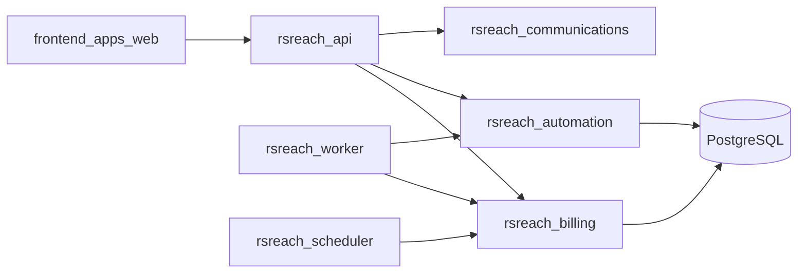

# Phase 5 — Commercial Launch Harden + Light UX

**Status:** Implementation authorized (A then light C).  
**Does not recreate:** `rsreach-billing`, `rsreach-automation`, Flyway V24–V29, existing billing/automation HTTP/UI.  
**Does not invent:** D2 commercial prices, Q7, DAG/AI automation, SSO, extra gateways.

## 1. Executive summary

Phase 5 makes RSReach safer for commercial operation: close P0/P1 security and ops gaps, complete entitlement enforcement, harden billing and linear automation verification, then add a thin customer/admin UX layer (shell, invites, password reset, platform grants/audit, notifications foundation).

## 2. Architecture (unchanged shape)

Three processes share one PostgreSQL database: API, worker, scheduler. Next Flyway version is **V30+** only. Outbox, `provider_webhook_events`, and `integration_secrets` remain the reliability primitives.

## 3. Phase 0–4 baseline

| Phase | Status | Evidence |
|---|---|---|
| 0–3.5 | Done | Prior reports; 3.5 residual ops carried into Phase 5 M0 |
| 4 | Closed | `docs/reports/phase-4-final-verification-report.md` |

## 4. Inventory (extend only)

Dual-realm auth, tenancy, contacts/consent, inbox/campaigns, flag-gated live connectors, MinIO ADR 0009, billing (plans, Razorpay port, entitlements), linear automation, customer/platform billing and automation UIs.

## 5–8. Gaps, risks, open decisions, backlog

See milestones below. Open: **D2** (config-only, no invented prices), **Q7** (out), Meta Embedded Signup (deferred), live Razorpay operator E2E (gated).

**P0:** Razorpay fail-closed; usage GET read-only; MinIO SigV4; Compose smoke checklist; README.  
**P1:** Entitlement hard gates; Razorpay live Orders behind flag; billing/automation IT; automation trigger bridges.  
**P2:** Thin UX/admin + notifications foundation + invoice/payments UI.  
**Out:** DAG/AI, SSO, second gateway, inventing D2/Q7.

## 9. Milestones

| ID | Objective |
|---|---|
| **M0** | Safety & ops baseline |
| **M1** | Entitlement completeness (members, accounts, media, pre-send deny) |
| **M2** | Billing harden (live Orders flag, refunds record, IT, invoice/payments UI) |
| **M3** | Automation reliability (trigger bridges, schedule, consent IT) |
| **M4** | Light UX/admin (shell, invites, password reset, grants/audit, notifications) |
| **M5** | Full verify + `docs/reports/phase-5-final-verification-report.md`; stop before future scope |

Sequence: **M0 → M1 → M2 → M3 → M4 → M5**.

## 10–13. Impact and out of scope

Extend existing modules; additive APIs; V30+ for notifications. Never edit V1–V29. No microservices, Redis, K8s, or Phase 4 greenfield rebuild.

## 14–15. Sequence and stop line

Implement M0–M5 then stop. Do not start Phase 6 / future-scope items without a new plan.
