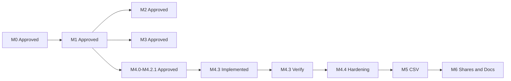

# Phase 2 — Remaining Milestones Execution Plan (M4.3 → M6)

**Date:** 2026-11-03  
**Mode:** Build — **COMPLETE** (M4.3 → M6 executed after plan approval)  
**Status:** M4.3 verified · M4.4 DONE · ADR 0006 accepted · M5 DONE · M6 DONE · final verify PASS  
**Sources of truth:** Repository ADRs, [`phase-2-contacts-organization-plan.md`](phase-2-contacts-organization-plan.md), [`phase-2-m4-duplicate-detection-merge-plan.md`](phase-2-m4-duplicate-detection-merge-plan.md), existing reports and code.  
**Stack locked:** Java 17, Spring Boot 3.3.x, PostgreSQL + Flyway, React/TS/Vite, modular monolith, no Redis/Kafka/K8s.

---

## Professional decisions (locked for this plan)

| Decision | Choice | Rationale |
|---|---|---|
| Undefined M5/M6 operational details | **Write ADR 0006 addendum before coding M5/M6**, locking defaults derived only from the approved Phase 2 plan | Market SaaS practice: ship with explicit limits and conflict policies; never invent mid-implementation |
| M4.3 → M4.4 gate | **Green M4.3 verification report = proceed** into M4.4 → M5 → M6 without further human milestone approvals | Matches master execution prompt; verification is the quality gate |
| M4.4 scope | **Hardening + full verify + report only** — no new product features | Exact wording of M4 plan §13 |

### ADR 0006 defaults (to be written at start of M5; not invented beyond plan + market norms)

| Topic | Locked default |
|---|---|
| Import conflict default | `SKIP` (D3) |
| Staging | PostgreSQL rows only; no object storage (D5/A6) |
| Max upload size | **10 MiB** |
| Max rows per import | **10,000** |
| Preview sync rows | First **100** validated inline; remainder validated on commit/worker |
| Worker batch size | **200** rows per `CONTACT_IMPORT_PROCESS` claim |
| Staging retention | Keep completed/failed job rows **30 days**; no auto hard-delete of contacts |
| UPDATE policy fields | `display_name`, mapped custom fields, add missing channels; **never** invent consent; consent columns only when explicit CSV columns mapped and `contacts.consent.manage` |
| CREATE_ANYWAY | Creates new contact even if duplicate channel exists elsewhere only if uniqueness allows; otherwise row `FAILED` with clear code (ACTIVE unique channel constraint wins) |
| Export consent columns | Include consent **status** with `contacts.read` (plan proposal) |
| Large export | Sync stream for ≤5k contacts; above that, worker-generated download job (same DB staging pattern) |
| Formula injection | Prefix risky cell values with `'` on export |
| Never infer consent | No marketing/WhatsApp opt-in from email/phone presence |
| Share expand | Directory/detail include home + active `CONTACT` shares **to** current workspace (plan §4) |
| Share WRITE | Update/archive allowed with share `WRITE` + `contacts.manage`; consent still requires home + `contacts.consent.manage` (ADR 0004) |
| CONTACT_GROUP share | **M6 minimal:** create/revoke share + list membership for target with `READ`; materialization stays home-workspace |
| Consent on share | **Never copy** consent into target workspace (ADR 0004/0005) |

If ADR 0006 conflicts with a later explicit product answer, stop and amend the ADR before coding further.

---

## 1. Current implementation assessment

| Area | Status |
|---|---|
| M0–M3 | Approved; contacts, groups, consent, suppression live |
| M4.0–M4.2.1 | Approved; detection, merge, concurrency tests |
| M4.3 | Frontend done: `frontend/apps/web/src/features/duplicates/` (5 routes, 27 Vitest tests); **awaiting verification report** |
| M4.4 | Not started — hardening / `mvn verify` / report |
| M5 | RBAC only (`contacts.import` / `contacts.export`); **no** import tables/APIs/UI |
| M6 | `resource_shares` V9 + merge revoke; **no** share create/list APIs, no share-expand reads, no share UI |
| Local PG | `rsreach_dev` + Flyway V1–V16 applied; docs under `docs/development/` |
| Docker/Testcontainers | Preserved; Compose app ports can conflict with native 8080 |

**Defects known from reports (non-blocking unless verification finds more):** M4.3 history shows UUIDs not names; scan is fire-and-forget; no live E2E screenshots; no frontend `lint` script.

---

## 2. M4.3 verification checklist

**Do not rewrite** working UI. Audit against backend contracts and plan §10 / §15.9.

| # | Check | Pass criteria |
|---|---|---|
| 1 | Routes wired in `App.tsx` | duplicates list/detail/merge; merges list/detail |
| 2 | Scan | `POST /contact-duplicates/scans`; loading/success/error; `contacts.manage` gated |
| 3 | List/filter/pagination | `status`, `contactId`, `page`, `size` only as API supports |
| 4 | Detail + evidence | Resolved matches; stale/DISMISSED/SUPERSEDED distinct |
| 5 | Dismiss/reopen | Permission + 409 messaging |
| 6 | Wizard A–F | Survivor, fields, channels, consent, groups/shares, confirm |
| 7 | Channel dispositions | RETAINED/MOVED/DEDUPED/LEFT_ARCHIVED/LEFT_INVALID |
| 8 | Consent downgrades | Backend preview authoritative; UNKNOWN / fresh consent shown |
| 9 | Idempotency | Same logical request reuses key; body change → new key; no auto-retry different body |
| 10 | 409 stale | Force preview refresh; no silent execute |
| 11 | History/detail | `contacts.read`; safe 404 |
| 12 | Tests | `npm run typecheck`, `npm test`, `npm run build`; repair only failing/missing coverage |
| 13 | No PII in console logs | Spot-check feature code |

**Deliverable:** [`docs/reports/phase-2-m4-m3-verification-report.md`](../reports/phase-2-m4-m3-verification-report.md)  
**Exit:** Checklist green or defects fixed; then auto-start M4.4.

---

## 3. Exact M4.4 scope (from M4 plan §13)

> **M4.4** | Hardening + `mvn verify` + report | Gate for M5

Concrete work:

1. Map M4 plan §12 test matrix (esp. cases 15–18, 30–31, 33–36, 39–42) to existing tests; add only **missing** coverage.
2. Full backend: `mvn -B verify` with Docker (Testcontainers **0 skipped** critical suites).
3. Frontend: typecheck + test + build.
4. Optional smoke: native API + Vite against `rsreach_dev` (non-destructive).
5. Report: `docs/reports/phase-2-m4-m4-implementation-report.md` (hardening/verification; not a feature dump).
6. Update M4 plan status: M4.3 verified + M4.4 done → M5 unblocked.

**Out of M4.4:** New APIs, schema, wizard redesign, CSV, share management UI.

---

## 4. M5 — CSV import / export (detailed)

**Authority:** Phase 2 contacts plan §10, §8 endpoints, D3/D5/A6 + **ADR 0006** defaults above.

### Backend modules

- `rsreach-contacts`: import/export services, CSV parse/normalize, duplicate policy, job state machine  
- `rsreach-api`: controllers under `/api/v1/app/contacts/import|export`  
- `rsreach-worker`: `CONTACT_IMPORT_PROCESS` (and large export if needed) via existing outbox  
- `rsreach-persistence`: Flyway **V17+** only

### Schema (new Flyway versions; never edit V1–V16)

- `contact_import_jobs` — status enum per plan §3  
- `contact_import_rows` — `row_number`, `payload` JSONB, `result`, `error_code`  
- Indexes: `(tenant_id, workspace_id, status)`, `(job_id, row_number)` unique  
- Optional `contact_export_jobs` if async export threshold exceeded

### APIs (plan §8; align paths with existing `/api/v1/app` style)

| Method | Path | Permission |
|---|---|---|
| `POST` | `/contacts/import/preview` | `contacts.import` |
| `POST` | `/contacts/import/{jobId}/commit` | `contacts.import` + `Idempotency-Key` |
| `GET` | `/contacts/import/{jobId}` | `contacts.import` |
| `GET` | `/contacts/export` | `contacts.export` |

### Safeguards

- Backend validates all rows; tenant/workspace from auth context only  
- No consent inference; suppression respected in validation messaging  
- SKIP/UPDATE/CREATE_ANYWAY explicit at commit  
- Failed commit must not leave orphan contacts unless row-level commit design is explicit (prefer **per-row transactions inside worker** after job marked RUNNING)  
- Audit: `contacts.import.committed`, `contacts.exported` — filename/counts/filters only

### Frontend

- `/app/contacts/import` — upload → mapping → preview table → commit → progress  
- Export CTA on directory (mirrors filters)  
- Permission-gated CTAs; reuse existing shell/styles

### Tests

- Unit: CSV parse, normalization, formula escape, policy  
- Testcontainers: isolation, authz, idempotent commit, row results, no consent inference  
- Frontend: preview error rows, permission hide, commit in-flight lock

**Report:** `docs/reports/phase-2-m5-implementation-report.md`

---

## 5. M6 — Workspace sharing, docs, final verification

**Authority:** Phase 2 plan §4, D6; ADR 0004/0005; M6 milestone exit = Compose smoke + `mvn verify` 0 skipped.

### Backend

- `POST /contacts/{id}/shares`, `DELETE /contacts/{id}/shares/{shareId}`, `GET` shares for contact  
- Optional parallel for `CONTACT_GROUP` (minimal)  
- Expand `ContactRepository` list/get: home **OR** active share-to-workspace  
- WRITE share: allow manage mutations; **deny** consent.manage unless home workspace  
- Audits: `contact.shared`, `contact.share_revoke` / existing `contact.share_revoked`  
- Preserve merge revoke behavior; shares never authorize merge (already tested)

### Frontend

- Share/revoke on contact detail  
- Directory indicates shared-in contacts  
- No privilege escalation UX (consent panel home-only)

### Documentation

- Update architecture/runbooks: import/export, sharing, local PG, Compose  
- Env/secrets, backup/restore notes, permission model  
- Phase 2 completion / verification report

### Final verification

- `mvn -B verify` (Docker)  
- Frontend typecheck/test/build  
- Compose up → health checks  
- Isolation, authz, contacts/groups/consent/duplicates/merge/import/export/share smoke  
- Confirm no secrets committed; Flyway history intact

**Reports:**  
- `docs/reports/phase-2-m6-implementation-report.md`  
- `docs/reports/phase-2-final-verification-report.md`

---

## 6. Dependency graph and sequence

| Stage | Depends on | Auto-continue when |
|---|---|---|
| M4.3 verify | Existing M4.3 code | Verification report green |
| M4.4 harden | M4.3 verify | `mvn verify` + frontend gates + report |
| ADR 0006 | M4.4 | Addendum committed |
| M5 | ADR 0006 | Tests + report |
| M6 | M5 | Tests + docs + final verify report |

Stop only for: destructive ops needing human OK, missing paid/external credentials, ADR conflict with product answer, unresolvable data-integrity risk.

---

## 7. Database migration plan

| Version | Milestone | Content |
|---|---|---|
| V1–V16 | Existing | **Immutable** |
| V17 | M5 | `contact_import_jobs`, `contact_import_rows` (+ indexes/FKs/checks) |
| V18 | M5 optional | Export job table if async export required |
| V19 | M6 if needed | Share helper indexes only if proven missing; prefer no schema if V9 sufficient |

Always: migrate fresh DB + upgrade from prior; Testcontainers migration tests; local `rsreach_dev` via Flyway on API start (no drop).

---

## 8. Backend / frontend impact map

| Milestone | Backend | Frontend |
|---|---|---|
| M4.3 | Fix only if contract defect | `features/duplicates/**` verify/fix |
| M4.4 | Tests/gaps in contacts + api IT | Regression only |
| M5 | contacts + api + worker + V17(+V18) | import/export pages, directory CTAs |
| M6 | contacts share services + query expand + api | share UI on detail; shared badge in directory |
| Docs | ADRs, runbooks, reports | — |

---

## 9. Testing and verification strategy

| Layer | Local PG | Docker/Testcontainers |
|---|---|---|
| Unit | Yes | — |
| API IT / isolation / jobs | Prefer Testcontainers (existing pattern) | Required for gate |
| Frontend Vitest | Yes | — |
| Full `mvn verify` | — | **M4.4 and M6 gates** |
| Compose smoke | — | **M6** |

Do not redirect Testcontainers to `rsreach_dev`. Do not skip or weaken tests. Frontend has no lint script today — note N/A unless one is added without scope creep (prefer document N/A).

---

## 10. Risks, blockers, assumptions

| Risk | Mitigation |
|---|---|
| Port 8080 clash with Compose | Stop Compose app containers for native runs (documented) |
| PG 17 Flyway warning | Informational; keep Boot 3.3 Flyway |
| Import UPDATE vs unique channels | ADR 0006: constraint wins; clear row error |
| Share-expand performance | Indexed `resource_shares` target; limit page size |
| Missing chatgpt transcript | Do not invent beyond approved plans + ADR 0006 |
| Large CSV memory | Stream parse; worker batches; size/row caps |

**Assumptions:** Master Build Mode approval of **this** plan authorizes M4.3→M6 sequence with ADR 0006 defaults; local PG password remains as configured in `.env.local`.

---

## 11. Estimated implementation stages

| Stage | Effort band | Output |
|---|---|---|
| S1 M4.3 verify | 0.5–1 day | Verification report |
| S2 M4.4 harden | 1–2 days | Matrix gaps filled; verify green; M4.4 report |
| S3 ADR 0006 | 0.5 day | Locked defaults |
| S4 M5 backend+worker | 3–5 days | V17, APIs, jobs |
| S5 M5 frontend+tests | 2–3 days | Import/export UX |
| S6 M6 shares+expand | 2–3 days | APIs + UI |
| S7 M6 docs+final verify | 1–2 days | Runbooks + final report |

---

## 12. Acceptance criteria per milestone

### M4.3
- Checklist §2 complete; contracts match controllers  
- Frontend typecheck/test/build pass  
- Verification report filed; no unjustified rewrite  

### M4.4
- §12 critical cases covered or explicitly mapped to existing tests  
- `mvn -B verify` SUCCESS, skipped = 0 for critical suites  
- Frontend gates pass  
- M4.4 report filed; M5 unblocked in plan status  

### M5
- Preview/commit/export working with authz  
- Row-level results; idempotent commit  
- No consent inference; isolation tests green  
- Suppression WARNING messaging; consent columns fail-closed on `contacts.consent.manage`  
- Async export above sync max via outbox/worker + job download  
- ADR 0006 respected; M5 report filed (`docs/reports/phase-2-m5-implementation-report.md`)  

### M6
- Share create/revoke; share-expand read (contacts + groups); WRITE limits; consent not copied  
- Home-only group share create/list/revoke; consent history fail-closed off-home  
- Frontend: no consent/edit escalation on shared-in; group share panel  
- Docs + final verification report (`phase-2-m6-implementation-report.md`, `phase-2-final-verification-report.md`)  
- Full `mvn verify` green (Skipped 0); Compose operator path documented when `.env` present  

### Phase 2 complete
- Parent plan §14 items 1–11 satisfied for contacts domain  

---

## Build Mode kickoff order

1. M4.3 verification (no feature rewrite)  
2. M4.4 hardening + verify  
3. ADR 0006  
4. M5  
5. M6 + final report  

**Do not implement until you explicitly switch to Build Mode and approve this plan.**
